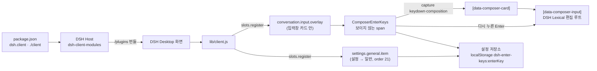
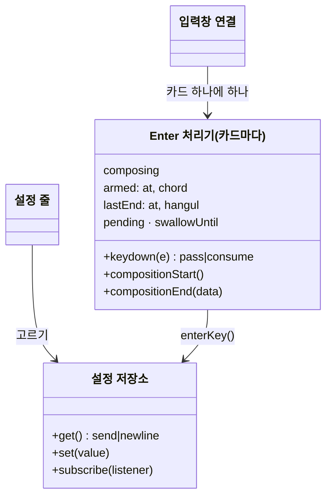
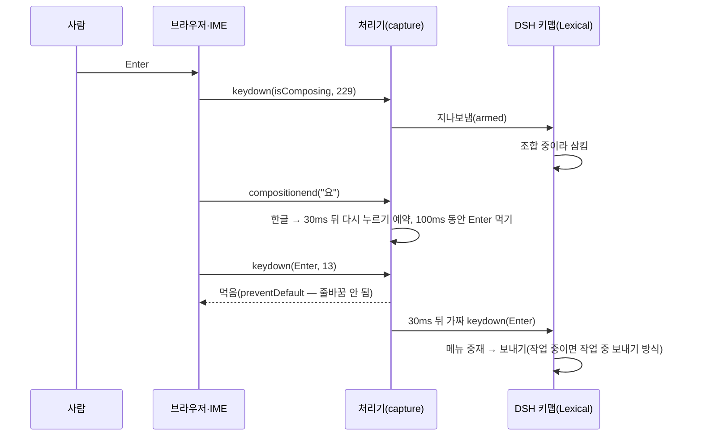
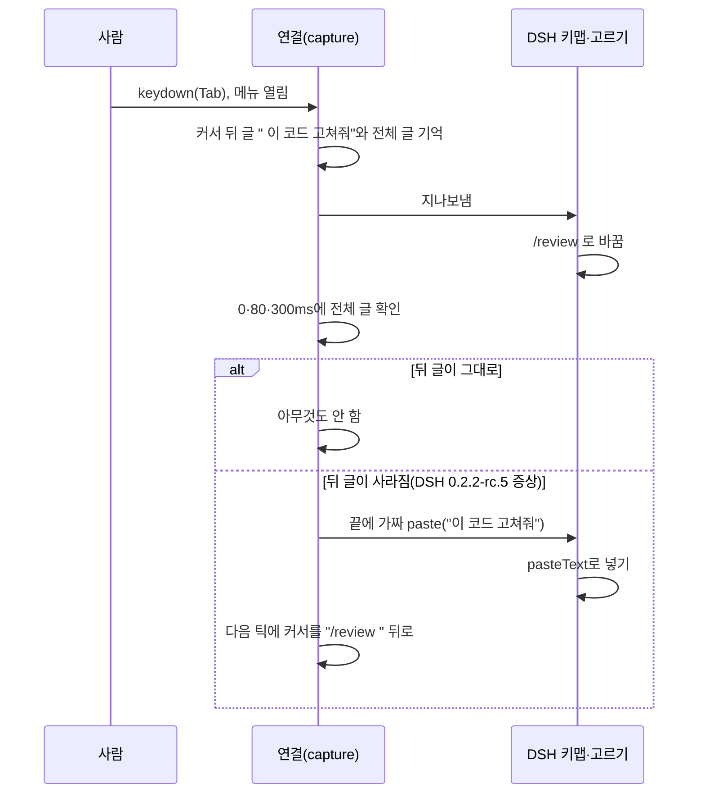

# dsh-enter-keys 구조

## 1. 연결 구조

| 부품 | 이어지는 곳 | 방법 |
|---|---|---|
| `package.json`·`cordis.patch.yml` | DSH Host | `dsh.client`(platform `web`) 선언과 `insert` 항목으로 번들을 싣게 함 |
| `lib/index.js` | DSH Host | 빈 `apply`. 플러그인 목록에 보이게 하는 자리뿐 |
| `lib/client.js` | DSH 화면 | `window.__ModuleLoader__.load`로 등록, `inject: ['slots']`. 공용 모듈은 `react`만 받음 |

## 2. 책임 나누기

| 부품 | 맡는 일 | 맡지 않는 일 |
|---|---|---|
| `src/tail-guard.js` | 지켜볼 키(`watchKind`), 뒤 글이 사라졌는지(`lostTail`), 되살릴 글(`restoreText`), 확인 시각(0·80·300ms) | DOM, 타이머, 붙여넣기 |
| `src/enter-rules.js` | Enter 조합 이름, 설정값 정리, 한글 판별, 입력창 하나의 처리기(`createEnterController`): 지나보낼지·먹을지, 언제 무엇을 다시 누를지 | DOM, 타이머, 저장소 |
| `src/client.template.js` `createSettingStore` | 설정 읽기·쓰기·알림, 저장소 실패 감싸기 | Enter 판단 |
| `attachComposer` | 카드 하나에 capture 듣기 걸기·떼기, 편집 루트 안 이벤트만 넘기기, 다시 누를 때 `KeyboardEvent` 만들기, 메뉴 열림 보기, 고르기 직전 커서 뒤 글 읽기(`readTail`)·되살리기(`appendViaPaste`)·커서 되돌리기(`pointAt`) | 보내기·줄바꿈 자체(DSH 몫) |
| `ComposerEnterKeys` | 자기 카드 찾기, 붙었다 떨어질 때 `attachComposer` 걸고 떼기 | 화면 그리기 |
| `EnterKeyRow` | 설정 줄(제목·설명·라디오 두 칸) | 저장 방식 |
| `apply` | 스타일 넣기, 다른 창 설정 따라가기(`storage` 이벤트), 자리 둘 등록 | |
| `scripts/build.mjs` | 템플릿 + 순수 모듈 + `style.css` → `lib/client.js` | |

## 3. 객체 관계

| 객체 | 갖는 것 | 관계 |
|---|---|---|
| 설정 | `send`(기본) 또는 `newline` | 화면 전체에 하나. 같은 저장소 키를 쓰는 다른 창과 `storage` 이벤트로 맞춤 |
| Enter 조합 | `plain`·`meta`·`ctrl`, 그 밖(Shift·Alt·Cmd+Ctrl)은 다루지 않음 | keydown 하나에서 만듦. `key`가 `Process`여도 `code`로 앎 |
| 처리기 상태 | 조합 중 여부, 조합 중 Enter(`armed`), 마지막 조합 끝(`lastEnd`), 다시 누르기 대기(`pending`), 먹는 시간(`swallowUntil`) | 입력창 카드 하나에 하나(같은 카드에 두 번 걸지 않음) |

## 4. 요청 순서

macOS 한글 입력에서 "안녕하세요"의 "요"를 조합하는 중 Enter를 누를 때(바로 보내기):

줄바꿈 설정이면 마지막 단계가 가짜 Shift+Enter이고, 조합이 아닐 때 Enter도 바로 Shift+Enter로 바꿔 누릅니다. 자동완성 메뉴가 열려 있으면 일반 Enter를 눌러 DSH가 항목을 고르게 합니다.

### 자동완성 뒤 글 지키기

글 `이 코드 고쳐줘` 앞에 `/revi`를 넣고 Tab을 누를 때:

사람이 그 사이 다른 키를 누르거나 글을 넣으면(`beforeinput`) 지켜보기를 그만둡니다.

원인(2026-11-25 조사): DSH 코드상 고르기는 `[토큰 시작, 커서)`만 바꿉니다(`span-map.ts` `$replaceDetectSpanWithText`). 같은 판 Lexical(0.49)과 DSH `span-map`·`projection`·`text-ref`·`detect` 원본으로 만든 재현 페이지에서는 실제 키 입력으로도 뒤 글이 남았습니다. 실제 앱에서는 아직 재현하지 못해 원인 줄은 모릅니다. 되살린 때 콘솔에 남는 줄(몇 ms에 잡았는지)로 원인을 좁힙니다.

## 5. 데이터 관계

| 데이터 | 출처 | 쓰는 곳 |
|---|---|---|
| `dsh-enter-keys:enterKey` | 설정 줄 | 처리기의 `enterKey()`. 저장소를 못 쓰면 이번 창 값만 바뀜 |
| `compositionend`의 `data` | 브라우저 | 한글인지(`isHangul`) |
| `[data-trigger-menu]`, `[data-composer-overlay] [role="listbox"]` | DSH 자동완성·명령 인자 창 | 메뉴 열림 |
| 편집 루트 글(`
`·` `)과 커서 | 브라우저 DOM | 고르기 직전 커서 뒤 글, 되살릴지 판단. 저장하지 않음 |

DSH에 쓰는 것은 없습니다. 메시지 보내기와 줄바꿈은 모두 DSH 편집기가 다시 누른 Enter를 받아 하고, 사라진 글은 DSH 편집기가 가짜 붙여넣기를 받아 넣습니다.

## 6. 지킬 경계

- 듣기는 자기 카드에만, 편집 루트 안을 향한 이벤트에만 반응합니다. 우리가 만든 가짜 이벤트(`isTrusted === false`)는 지나보냅니다.
- DSH 내부 객체(Lexical editor, `ComposerKeyboard`, 입력 상태 기계)에 손대지 않습니다.
- 판단에서 오류가 나면 지나보내 DSH 기본 동작으로 둡니다.

## 7. 고치는 때

- DSH 키맵의 조합 끝 대기(10ms)나 DOM 표시(`data-composer-card`·`data-composer-input`·`data-trigger-menu`)가 바뀔 때: `AGENTS.md` "새 DSH 버전이 나오면".
- 새 키 동작을 더할 때: `src/enter-rules.js`와 `test/enter-rules.test.mjs`부터 고치고, 이 문서 2·4절을 같이 고칩니다.
