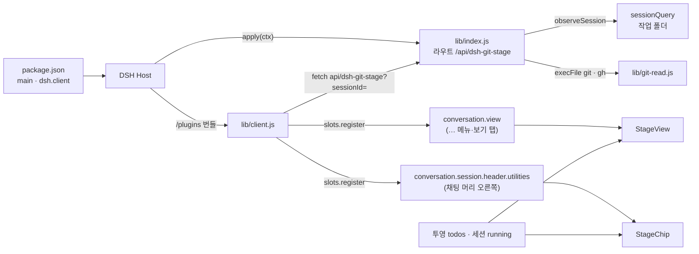
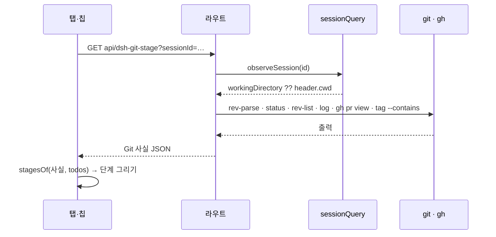

# dsh-git-stage 구조

## 1. 연결 구조

| 부품 | 이어지는 곳 | 방법 |
|---|---|---|
| `package.json`·`cordis.patch.yml` | DSH Host | `main`(서버)과 `dsh.client`(platform `web`) 선언 |
| `lib/index.js` | DSH Host | `inject: ['connection', 'sessionQuery']`, `ctx.connection.fetch.register`로 GET 라우트 하나 |
| `lib/client.js` | DSH 화면 | `window.__ModuleLoader__.load`로 등록, `inject: ['slots']`. 공용 모듈은 `react`·`react-dom`만 받음 |
| 휴대폰 앱 | `plugins/handheld` | `src/stages.js`·`lib/git-read.js`의 복사본을 씀(키트 루트 테스트가 같은지 봄) |

## 2. 책임 나누기

| 부품 | 맡는 일 | 맡지 않는 일 |
|---|---|---|
| `src/stages.js` | Git 사실 + 할 일 → 여섯 단계 스냅샷(끝남·지금·남음·기록 없음, 승인 필요, 막힘), 지금 하는 일, 검증 완료 판단 | 문구, 화면, 명령 실행 |
| `src/stage-text.js` | 단계 이름·쉬운 뜻·상태 글자, 사실 줄, 다음 할 일, 요약 한 줄 | 단계 판단 |
| `src/source.js` | 라우트 부르기, 구독 중에만 10초마다 다시 읽기, 겹친 요청 합치기, 실패 때 직전 사실 유지 | 화면 |
| `lib/git-read.js` | 읽기 전용 `git`·`gh` 명령 → Git 사실, `gh` 오류 분류, PR 30초 캐시. 작업 폴더가 저장소가 아니면 `findRepos`로 안의 저장소를 최근 활동 순으로 찾아(파일만 봄, 세 단계까지) 고른 것 또는 가장 최근 것을 읽음 | 단계 판단 |
| `lib/index.js` | 세션 id 확인 → 작업 폴더 찾기 → 사실 JSON. 400·404·500 응답 | Git 해석 |
| `StageView`·`Stepper`·`StageDetail` | 탭 그리기, 단계 고르기(키보드 포함), 설명 칸 | 데이터 모으기 |
| `RepoPicker` | 저장소 묶음 폴더일 때 저장소 고르기, 고른 이름을 세션마다 localStorage에 기억 | 경로 만들기(이름만 보냄) |
| `StageChip` | 칩과 단계 목록 창(포털), 창 열고 닫기·초점 | 탭 이동 |
| `scripts/build.mjs` | 템플릿 + 순수 모듈 + `style.css` → `lib/client.js` | |

## 3. 객체 관계

| 객체 | 갖는 것 | 관계 |
|---|---|---|
| Git 사실 | `repo`, `folder`, `branch`, `base`, `isBase`, `changes`, `ahead`, `upstream`, `unpushed`, `hadCommits`, `headTime`, `pr`, `prError`, `tag` | 세션 작업 폴더 하나에 하나. 요청마다 새로 읽음 |
| 묶음 정보 `within` | `folder`(바깥 폴더 이름), `repos`(최근 활동 순 이름 최대 40개), `picked`, `auto` | 작업 폴더가 저장소가 아닐 때만. Git 사실의 `folder`는 고른 저장소 이름(상대 경로) |
| PR | `number`, `state`, `draft`, `url`(https만), `mergeCommit` | 브랜치 이름으로 `gh pr view`. 없으면 null |
| 단계 스냅샷 | `kind`(`loading`·`no-repo`·`ok`), `stages[6]`, `current`, `done`, `total`, `doing` | Git 사실 + 투영 `todos`에서 렌더 때마다 다시 만듦 |
| 단계 | `key`, `status`, `approval`, `blocked`, `info` | 단계 여섯 개는 순서가 고정 |

## 4. 요청 순서

| 단계 | 하는 일 |
|---|---|
| 1 | 탭이나 칩이 보이면 구독을 시작하고 바로 한 번, 그 뒤 10초마다 읽음. 세션이 작동 중 → 멈춤으로 바뀌면 바로 다시 읽음 |
| 2 | 서버가 세션 id 모양을 확인하고 작업 폴더를 찾음. 화면이 보낸 경로는 쓰지 않음. 묶음 폴더면 `?repo=` 이름이 찾은 목록에 있을 때만 그 저장소, 아니면 가장 최근 저장소 |
| 3 | 읽기 전용 명령만 돌려 사실을 만듦. `gh` 실패는 분류 이름만 남김 |
| 4 | 화면이 할 일 투영과 합쳐 단계를 칠함 |

## 5. 데이터 관계

저장소가 없습니다. 모든 값은 요청 때 Git과 세션 투영에서 다시 만듭니다. 서버는 PR 결과를 메모리에 30초만 들고 있습니다.

## 6. 지킬 경계

- 화면이 고른 저장소는 이름으로만 오고, 서버가 찾은 목록 밖의 이름(`../..`, 절대 경로)은 무시합니다.
- Git·GitHub 상태를 바꾸지 않습니다. 네트워크를 타는 `git` 명령도 없습니다(원격 정보는 마지막으로 받아 둔 로컬 참조만 봄).
- DSH 공식 자리·서비스만 씁니다. DSH가 만든 DOM을 건드리지 않습니다.
- 단계 규칙은 `src/stages.js`에만 있습니다. 휴대폰 앱 사본과 Claude Code 모드(`~/.claude/dev-mods/…/work-stage`, TypeScript로 옮김)는 이 규칙을 따릅니다.

## 7. 고치는 때

책임·경계·데이터 관계를 바꾸는 PR이 이 문서를 같이 고칩니다.
