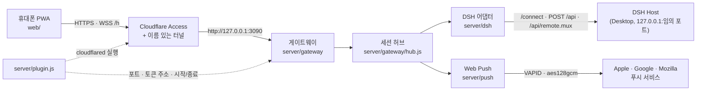
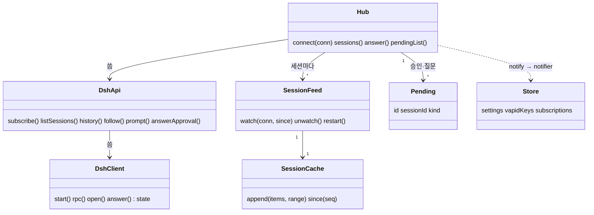

# dsh-handheld 구조

## 1. 연결 구조

| 부품 | 이어지는 곳 | 방법 |
|---|---|---|
| `server/plugin.js` | DSH Host | DSH가 플러그인을 불러올 때 `apply(ctx)`. `ctx.webServer`·`ctx.connection.authenticatedUrl()`만 씁니다 |
| `server/dsh/` | DSH Host | API 손님: `/connect?interactions=answer`로 쿠키를 받고, 단발 호출은 `POST /api/<endpoint>`, 흐름은 `/api/remote.mux` 하나에 묶습니다 |
| `server/gateway/` | 휴대폰 | `127.0.0.1:3090`의 HTTP(PWA 파일, `/h/api`)와 WebSocket(`/h/live`) |
| `server/push/` | 푸시 서비스 | 의존성 없는 RFC 8291·8292 구현 |
| `web/` | 게이트웨이 | 빌드한 정적 파일을 게이트웨이가 `/h/`에서 내줍니다 |

## 2. 책임 나누기

| 부품 | 맡는 일 | 맡지 않는 일 |
|---|---|---|
| `server/dsh/connection.js` | 쿠키 교환, RPC 봉투 | 재연결 판단 |
| `server/dsh/mux.js` | 논리 흐름 열기·닫기, 프레임 해석 | 하트비트(DSH의 Ping에는 `ws`가 자동으로 Pong) |
| `server/dsh/client.js` | DSH 연결 하나의 수명, 백오프 재연결, `$events` 준비 확인 | 화면용 모양 |
| `server/dsh/normalize.js` | DSH 이벤트 → 우리 항목(`server/protocol.js`) | 저장 |
| `server/dsh/api.js` | 게이트웨이가 쓰는 동작(목록·기록·팔로·보내기·답하기)을 DSH 호출로 바꾸기, DSH 알림을 우리 말로 바꾸기 | 보관·재개 |
| `server/gateway/hub.js` | 휴대폰 연결 목록, 세션 목록, 대기 중 승인·질문, 알림 보낼 때 판단 | 세션 하나의 흐름 |
| `server/gateway/feed.js` | 세션 하나: 보는 사람이 있을 때만 DSH 팔로 유지, 보관함(`session-cache.js`), 이어보기·빈 구간 채우기, 답변 글 묶어 보내기 | HTTP·인증 |
| `server/gateway/access-auth.js` | Access JWT 검증, 허용 이메일 | 세션 쿠키(Access가 맡음) |
| `server/gateway/server.js` | 누가 묻는지(Access·개발 우회), Origin 확인, 보안 헤더, 정적 파일, `/h/live` 연결 받기 | DSH 규약 |
| `server/gateway/routes.js` | `/h/api` 하나하나의 처리 | 인증 |
| `server/gateway/git-read.js` | 세션 작업 폴더의 Git 사실을 읽기 전용 `git`·`gh`로 읽기(`plugins/git-stage` 복사본). `GET /h/api/sessions/:id/stages`가 허브의 `stages()`로 부름. 작업 폴더·할 일은 `server/dsh/api.js`의 `workState()`(DSH `session/projections`), 세션이 돌린 명령은 같은 함수가 `session/events`(최근 메시지 30개)에서 `normalize.js`의 `commandsOf()`로 뽑아 묶음 폴더 안 저장소를 고르는 데 씀 | 단계 판단(화면의 `web/src/lib/stages.js`) |
| `server/gateway/live.js` | 휴대폰 WebSocket 하나의 규약(hello·watch·ping) | |
| `server/push/web-push.js` | 암호화·VAPID·발송 | 언제 보낼지 |
| `server/push/notifier.js` | 허브 알림 → 푸시 문구·긴급도, 사라진 구독 지우기 | 암호화 |
| `server/store.js` | `$DSH_HOME/dsh-handheld/` 설정·키·구독(0600), 푸시 주소 검사 | |
| `server/app.js` | 위 부품을 한 번에 엮기(플러그인과 `npm run dev`가 같이 씀) | |
| `server/tunnel.js` | `cloudflared tunnel run` 실행·재시작, 토큰은 환경 변수로만 | |
| `web/src/` | 화면, 입력, 오프라인 표시, 서비스 워커 | DSH 규약 |

## 3. 객체·데이터 관계

언어: 화면 글자는 `web/src/locale/`의 문구집 다섯 개(한국어가 기준)에 있고 `web/src/lib/i18n.js`의 `t()`가 고른 언어로 읽습니다. 고른 언어는 휴대폰에 저장하고 게이트웨이 설정(`lang`)에도 보내서, 푸시 알림 글(`server/push/text.js`)이 같은 언어로 나갑니다. 게이트웨이 오류는 코드(`code`)로 구분해 휴대폰이 자기 언어로 보여 줍니다.

계획 검토: DSH가 질문으로 보내는 계획 검토는 `server/dsh/api.js`가 `review: { approve, revise }`를 붙여 넘기고, 휴대폰은 그것을 계획 본문과 "승인·수정 요청" 단추로 그립니다(`web/src/components/PendingSheet.jsx`).

명령어: 세션이 받는 `/명령` 목록은 `GET /sessions/:id/commands`, 실행은 `POST /sessions/:id/command`입니다. 게이트웨이는 DSH의 `commands/list`·`commands/execute`를 그대로 잇고, 휴대폰 입력창(`web/src/components/Composer.jsx`)이 목록에 있는 이름으로 시작하는 줄만 명령으로 보냅니다. 고른 명령은 입력창에 넣기만 하고, 사람이 보내야 실행됩니다.

작업 단계 요청: 단계 시트(`web/src/screens/Chat.jsx`의 `StageAsk`)의 "입력창에 넣기"는 `Composer`의 `fill` 속성(`{text, n}`)으로 문장을 넘깁니다. 입력창은 쓰던 글 뒤에 줄을 바꿔 붙이고 초점만 옮깁니다. 보내기는 사람이 누릅니다. 문장은 `web/src/lib/stage-view.js`의 `stageAsk()`가 단계와 5개 언어 문구(`stage.a.*`)로 만듭니다.

하위 에이전트: 부모 세션의 하위 에이전트 목록은 `DshApi.subagents()`가 DSH의 세션 투영(`subagentCatalog`)과 세션 목록 줄에서 만듭니다. 휴대폰에는 `sub~부모~자식~방식` 꼴의 불투명한 이름으로 나가고, 이 이름을 DSH 주소로 푸는 곳은 `server/dsh/`뿐입니다. 하위 에이전트 대화는 세션과 같은 흐름(`SessionFeed`)으로 따라가되 보기 전용이라 허브가 글 보내기와 중단을 거절합니다.

- 이어보기 커서는 DSH의 세션별 durable `seq`입니다. 휴대폰은 마지막으로 받은 `seq`를 `hello`·`watch`에 실어 보냅니다.
- 허브의 보관함에 그 뒤가 다 있으면 보관함에서 바로 보냅니다. 없으면 허브가 DSH `session/events`로 모자란 구간만 가져와 채운 뒤 보냅니다. 어느 쪽이든 한 프레임은 64KB를 넘지 않습니다.
- 스트림 글(`assistant-stream`)은 임시입니다. 같은 턴의 확정 `assistant` 항목이 오면 휴대폰은 임시 글을 지웁니다.

## 4. 지킬 경계

- DSH 이름(`session/follow`, `$events`, `assistant-stream` 등)은 `server/dsh/` 밖에 나오지 않습니다.
- 게이트웨이는 `127.0.0.1`에만 엽니다. 루프백이 아닌 곳에 열 설정은 없습니다.
- 외부 요청은 Access JWT 검증을 통과해야 합니다. WebSocket 업그레이드와 POST는 `Origin`이 설정한 공개 주소와 같아야 합니다.
- 개발 모드(`devNoAuth`)는 요청 주소와 Host가 모두 루프백일 때만 인증을 건너뜁니다. 터널을 거친 요청은 Host가 공개 주소이므로 이 우회를 탈 수 없습니다.
- 승인 답은 휴대폰에서 사람이 누른 요청으로만 나갑니다. 허브는 스스로 답하지 않습니다.
