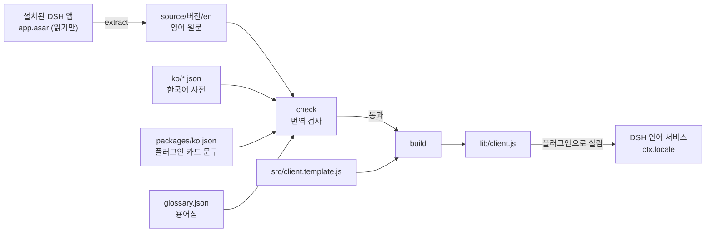

# dsh-korean 구조

## 1. 연결 구조

| 부품 | 이어지는 곳 | 방법 |
|---|---|---|
| 추출기 | 설치된 앱 → `source/` | `app.asar`를 풀지 않고 읽어 영어 사전을 JSON으로 저장 |
| 검사기 | `source/`, `ko/`, `packages/`, `glossary.json` | 원문과 번역을 키 단위로 대조 |
| 빌드 | `ko/`, `packages/`, 틀 → `lib/client.js` | 검사 통과 뒤 사전과 카드 문구 표를 틀에 넣음 |
| 런타임 번들 | DSH 언어 서비스 | `addLanguage`로 한국어를 추가하고 네임스페이스마다 `register`. 플러그인 카드 문구는 `resolveText`를 감싸서 돌려줌 |

## 2. 책임 나누기

| 부품(폴더·모듈) | 맡는 일 | 맡지 않는 일 |
|---|---|---|
| `scripts/asar.mjs` | asar 헤더를 읽어 파일 목록과 내용을 돌려줌 | 파일 쓰기, 풀기 |
| `scripts/ts-modules.mjs` | asar 안 TypeScript 모듈을 불러와 값을 얻음 | 어떤 모듈이 사전인지 판단 |
| `scripts/extract.mjs` | 사전 등록 호출을 찾아 네임스페이스와 영어 사전을 정하고 스냅샷을 씀 | 번역, 검사 |
| `scripts/dictionary.mjs` | 스냅샷·번역·용어집을 디스크에서 읽음 | 규칙 판단 |
| `scripts/check.mjs` | 번역 규칙을 검사하고 번역률을 냄 | 파일 고치기 |
| `scripts/build.mjs` | 검사 뒤 번들을 만듦 | 번역 규칙 정의 |
| `src/font-picker.js` | 설정 → 일반에 글꼴 고르는 줄을 넣고, 고른 값을 DSH 글꼴 설정에 씀. 빌드가 번들에 통째로 넣음 | 글꼴 파일 배포, 글꼴 적용(앱이 함) |
| `src/client.template.js` | 앱 안에서 언어와 사전을 등록하고, 한국어 표가 없는 플러그인 카드 문구를 한국어로 돌려줌 | 화면 요소를 직접 바꾸기 |
| `ko/*.json` | 네임스페이스별 한국어 사전 | 영어 원문 보관 |
| `packages/ko.json` | 내장 플러그인 카드의 이름·설명 번역 | 다른 사람이 만든 플러그인의 문구 |
| `glossary.json`, `STYLE.md` | 용어와 문체의 기준 | 개별 문구 |

## 3. 데이터 관계

| 데이터 | 형식 | 만드는 쪽 | 읽는 쪽 |
|---|---|---|---|
| `source/<버전>/en/<ns>.json` | `{ 키: 영어 문구 }` | 추출기 | 검사기, 번역하는 사람 |
| `source/<버전>/index.json` | 네임스페이스별 패키지·키 수·모든 언어에서 같은 키 목록 | 추출기 | 검사기 |
| `source/<버전>/main-en.json` | 메인 프로세스 사전(메뉴 등). 언어팩으로 바꿀 수 없어 참고용 | 추출기 | 사람 |
| `source/<버전>/packages-en.json` | `{ "<패키지>:title" 또는 "<패키지>:description": 영어 문구 }`. 패키지의 `locale/en.json`에서 뽑으며, 패키지 이름 조각 그대로인 제목은 뺌 | 추출기 | 검사기, 번역하는 사람 |
| `ko/<ns>.json` | `{ 키: 한국어 문구 }` | 번역하는 사람 | 검사기, 빌드 |
| `desktop/ko.json` | `main-en.json`과 같은 키에 한국어 문구. 앱에는 적용되지 않고 검사만 받음. 용어집에서는 `@desktop`으로 가리킴 | 번역하는 사람 | 검사기, 상위 저장소 제안 |
| `packages/ko.json` | `packages-en.json`과 같은 키에 한국어 문구. 용어집에서는 `@packages`라는 이름으로 가리킴 | 번역하는 사람 | 검사기, 빌드 |
| `glossary.json` | `terms`(용어), `keep`(영어로 두는 말), `verbatimKeys`(원문 그대로 두는 키), `exceptions`(용어 규칙을 건너뛰는 키) | 사람 | 검사기 |

## 4. 지킬 경계

- 앱 파일에는 쓰지 않습니다. 추출기는 읽기 전용으로만 엽니다.
- 런타임 번들은 DSH가 공개한 언어 서비스만 다룹니다. 앱 내부 구조(CSS 클래스 이름, DOM 모양)에 기대는 코드를 넣지 않습니다.
- 언어 서비스에서 감싸는 함수는 `resolveText` 하나뿐입니다. 화면 언어가 한국어이고 표에 한국어가 없으며 영어 원문이 `packages/ko.json`에 있을 때만 값을 바꾸고, 나머지는 원래 함수에 넘깁니다. 언어팩을 끄면 원래대로 되돌립니다. 같은 영어 원문에는 번역이 하나여야 합니다(검사기의 `package-conflict`).
- 검사를 통과하지 못한 사전으로는 번들을 만들지 않습니다.
- `lib/client.js`와 `source/`는 스크립트만 씁니다.
- DSH는 꾸러미 하나에 화면 번들 하나만 싣습니다. 그래서 글꼴 고르기는 별도 꾸러미가 아니라 이 번들 안의 하위 플러그인(`dsh-korean:font-picker`)으로 붙입니다. 테마·설정 화면 서비스가 준비됐을 때만 돌고, 없어도 번역은 동작합니다.
- 글꼴 고르기는 앱이 공개한 `ctx.theme.setFontFamily`와 `settings.general.item` 자리만 씁니다.

## 5. 고치는 때

책임·경계·데이터 관계를 바꾸는 변경은 같은 커밋에서 이 문서를 고칩니다.
