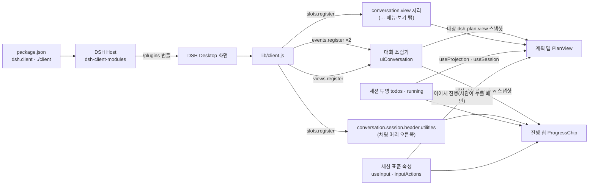
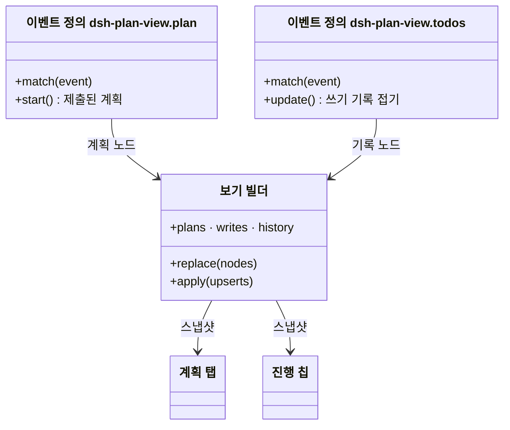
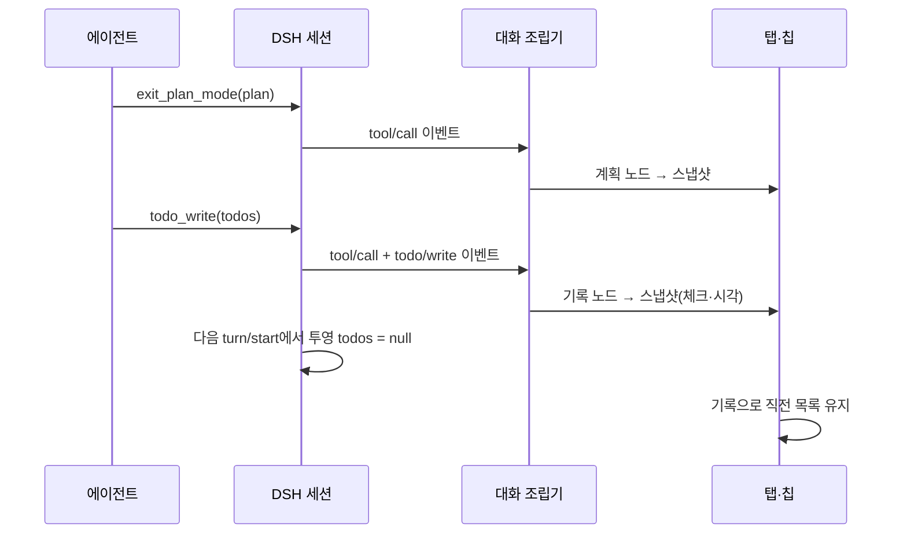

# dsh-plan-view 구조

## 1. 연결 구조

| 부품 | 이어지는 곳 | 방법 |
|---|---|---|
| `package.json`·`cordis.patch.yml` | DSH Host | `dsh.client`(platform `web`) 선언과 `insert` 항목으로 번들을 싣게 함 |
| `lib/index.js` | DSH Host | 빈 `apply`. 플러그인 목록에 보이게 하는 자리뿐 |
| `lib/client.js` | DSH 화면 | `window.__ModuleLoader__.load`로 등록, `inject: ['slots', 'uiConversation']`. 공용 모듈은 `react`·`react-dom`만 받음 |

## 2. 책임 나누기

| 부품 | 맡는 일 | 맡지 않는 일 |
|---|---|---|
| `src/markdown.js` | 계획 문서 마크다운 → 노드 나무(블록·인라인), 안전하지 않은 링크·HTML·그림 막기 | React, 화면 |
| `src/plan.js` | 세션 이벤트 → 제출된 계획(제목·본문), 계획 노드, 할 일 목록 정리·요약 | 화면, DSH 서비스 호출 |
| `src/todo-history.js` | `todo/write`·`todo_write` 호출을 접어 쓰기 기록 만들기, 턴별 묶음·항목 시각, 지금 보여 줄 목록, 시간 글자 | 화면 |
| `src/plan-check.js` | 계획 문서 목록 줄과 할 일 문구 맞추기(2-gram 유사도), `- [x]`로 고쳐 쓰기 | 화면 |
| `src/view-builder.js` | 계획 노드·기록 노드 → 탭과 칩이 읽는 스냅샷 하나 | 데이터 해석 |
| `src/resume.js` | 멈춘 할 일 판단(`resumeStateOf`), 보낼 요청 문장, 빈 입력창이면 채워 보내고 쓰던 글이 있으면 덧붙이기(`sendResume`) | 화면, 자동 보내기 |
| `src/client.template.js` `apply` | 스타일 넣기, 이벤트 정의 둘·보기 대상·자리 둘 등록 | 데이터 해석 |
| `PlanView`·`TodoSection`·`PastSection`·`PlanSection`·`Markdown` | 탭 그리기, 실시간 변화 표시, 마크다운 노드 그리기 | 데이터 모으기 |
| `ProgressChip` | 칩과 할 일 창(포털), 창 열고 닫기·초점, 멈춤 점 | 탭 이동(머리 자리에는 보기를 바꾸는 함수가 없음) |
| `useResume`·`ResumeBar` | 탭 할 일 칸 아래와 칩 창에 "이어서 진행" 줄, 결과 알림(`role=status`) | 언제 보일지 판단(`src/resume.js`) |
| `scripts/build.mjs` | 템플릿 + 순수 모듈 + `style.css` → `lib/client.js` | |

## 3. 객체 관계

| 객체 | 갖는 것 | 관계 |
|---|---|---|
| 제출된 계획 | `callId`, `title`, `markdown`, `seq` | `exit_plan_mode` 호출 하나에 하나 |
| 쓰기 기록 | `seq`, `time`, `turn`, `callId`, `todos` | `todo/write` 이벤트 하나에 하나. 바로 앞 `todo_write` 호출 id를 붙임. `seq`가 같거나 작으면 버림 |
| 턴 묶음 | `turn`, `startedAt`, `endedAt`, `items`, `done`, `total` | 같은 턴의 쓰기들. 가장 최근 턴이 `current`, 나머지가 `past` |
| 할 일 항목 | `content`, `status`, `startedAt`, `completedAt`, `startCallId`, `doneCallId` | 문구가 같은 항목끼리 턴을 넘어 시각이 이어짐 |
| 마크다운 노드 | 블록(`heading`·`paragraph`·`list`·`table`·`code`·`quote`·`rule`)과 인라인(`text`·`strong`·`em`·`del`·`code`·`link`·`break`) | 렌더 때마다 계획 본문에서 다시 만듦 |

## 4. 요청 순서

| 단계 | 하는 일 |
|---|---|
| 1 | 탭이나 칩이 그려지면 `inject(sessionId)`가 `uiConversation.binding(sessionId).target('dsh-plan-view')`를 구독해 대상을 깨움 |
| 2 | 조립기가 세션 이벤트를 훑어 계획 노드와 기록 노드를 만들고 빌더가 스냅샷 하나로 묶음 |
| 3 | 화면은 스냅샷의 기록을 먼저 쓰고, 기록이 아직 없으면 투영 `todos`로 대신함 |
| 4 | 계획을 실행한 턴(제출한 턴·승인 뒤 다음 턴)의 할 일로 실행 상태를 만들고, 문서 줄은 그 할 일과 문구를 견줘 체크한 뒤 `src/markdown.js`로 해석해 그림 |

## 5. 데이터 관계

저장소가 없습니다. 모든 값은 DSH 세션 기록(이벤트)과 투영에서 매번 다시 만듭니다. 플러그인이 DSH에 쓰는 것은 사람이 "이어서 진행"을 눌렀을 때의 요청 메시지 하나뿐입니다.

"이어서 진행"은 지금 목록에 완료가 아닌 항목이 있고, 세션이 돌지 않으며(`running` 거짓), 입력창이 보내는 중이 아니고(`phase`가 `plain`, `pendingSubmissions` 없음), 하위 에이전트 세션이 아닐 때 보입니다. `lastAgentError`가 있으면 "오류로 멈췄어요"라고 씁니다.

계획 카드의 실행 상태는 `seq > 계획.seq`이면서 턴이 계획의 턴이나 바로 다음 턴이고, 다음 계획(`seq`가 더 큰 계획)보다 앞선 `todo/write`로 만듭니다. 그 뒤 턴의 할 일은 새 요청의 기록이라 세지 않습니다.

## 6. 지킬 경계

- DSH 공식 자리·서비스만 씁니다. DSH가 만든 DOM을 건드리지 않습니다.
- Harness Client 패키지(`@deepseek-ai/dsh-client-ui-primitives` 등)를 불러오지 않습니다. 필요한 부품은 직접 그립니다.
- 채팅 쪽 계획 카드(`dsh-client-ui-plan`)·할 일 칸과 데이터를 나누지 않고, 같은 이벤트를 자기 대상(`dsh-plan-view`)으로 따로 모읍니다.
- 할 일과 계획은 에이전트 것입니다. 화면에서 체크해도 DSH에 쓰지 않습니다.
- 메시지는 사람이 "이어서 진행"을 누를 때만 보냅니다. 쓰던 글이 있으면 지우거나 함께 보내지 않고 덧붙이기만 합니다.

## 7. 고치는 때

책임·경계·데이터 관계를 바꾸는 PR이 이 문서를 같이 고칩니다.
