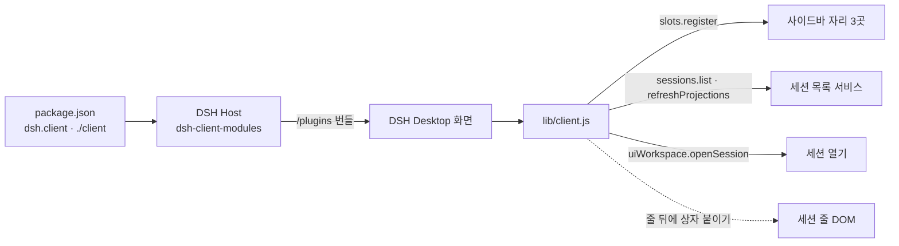

# dsh-subagent-tree 구조

## 1. 연결 구조

| 부품 | 이어지는 곳 | 방법 |
|---|---|---|
| `package.json`·`cordis.patch.yml` | DSH Host | `dsh.client`(platform `web`) 선언과 `insert` 항목으로 번들을 싣게 함 |
| `lib/index.js` | DSH Host | 빈 `apply`. 플러그인 목록에 보이게 하는 자리뿐 |
| `lib/client.js` | DSH 화면 | `window.__ModuleLoader__.load`로 등록, `inject: ['sessions', 'uiWorkspace', 'slots']` |

## 2. 책임 나누기

| 부품 | 맡는 일 | 맡지 않는 일 |
|---|---|---|
| `src/tree.js` | 세션 목록 상태 → 자식 줄(제목, 상태, 여는 주소) | 화면, 새로고침 |
| `src/client.template.js` `createModel` | 목록 구독, 투영 새로고침 간격, 세션 열기 | 그리기 |
| `Trailing` | ① 줄 끝 아이콘, ③ 자식 줄을 붙일 기준점과 portal | 접기 버튼(이 영역은 hover 때 숨겨짐) |
| `Hover` | ② 카드 안 자식 목록 | |
| `Toggle` | ③ 접기·펼치기 버튼 | |
| `useRowSibling` | 세션 줄 바로 뒤에 상자 붙이기, 줄이 옮겨지면 따라가기, 부모 제목 위치(`--dst-title-left`)를 재서 연결선 시작점 맞추기 | DSH 요소 고치기 |
| `src/style.css` | 모든 모양. DSH 색 변수(`--dsw-alias-*`)를 쓰고 없으면 기본값 | |
| `scripts/build.mjs` | 세 파일을 합쳐 `lib/client.js` 만들기 | |

## 3. 데이터 관계

- 자식 목록: `sessions.list.getSnapshot().projectionsBySession[부모].values.subagentCatalog`. `mode: 'external'`(바깥 실행)은 열 세션이 없어 뺍니다.
- 상태: 자식 요약 `byId[자식].running`이면 실행 중, `projectionValues.subagentTiming.lastTurnCompleted`가 `true`면 끝남, `false`면 중단됨, 그 밖에는 대기.
- 지금 열린 자식: `byId[자식].retainedBy.mainView > 0`.
- 여는 주소: `{ kind: 'subagent', parentSessionId, childSessionId, mode }`. DSH 머리말의 하위 에이전트 목록과 같은 모양입니다.
- 펼침 상태는 화면 메모리에만 있고 새로 열면 모두 펼침입니다.

## 4. 지킬 경계

- 공식 자리 밖에서 하는 일은 `useRowSibling` 한 곳뿐입니다.
- 투영 새로고침은 세션마다 5초 간격, 카드를 열 때만 바로 합니다.
- 자식 줄은 `role="group"` 안의 버튼입니다. DSH 나무의 `treeitem`으로 끼어들지 않아 DSH 키보드 이동을 흐트러뜨리지 않습니다.
